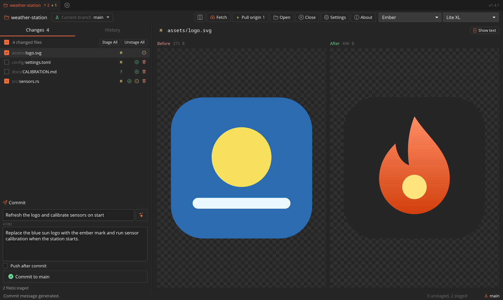

<div align="center">

# GitKraft (fork)



**English** · [Русский](#русский)

</div>

## English

A fork of **[sorinirimies/gitkraft](https://github.com/sorinirimies/gitkraft)**, a fast,
lightweight Git client written in Rust (desktop GUI on Iced plus a terminal UI). The fork
keeps everything the original does and adds a simpler everyday workflow on top: a two-pane
layout, image diffs, AI commit messages and a few conveniences.

Full documentation of the original features (keyboard shortcuts, TUI, architecture) is in
the [original README](https://github.com/sorinirimies/gitkraft#readme).

### What's different in this fork (GUI)

- **Two-pane layout** (default). Left column with *Changes* / *History* tabs: changed files
  with checkboxes (checked = staged), per-file stage / unstage / discard, *Stage All* /
  *Unstage All*, and the commit box underneath. Branches, stashes and remotes open from the
  *Current branch ▾* button. The toolbar button next to *Fetch* switches back to the classic
  layout.
- **Push / pull at a glance.** Each repository tab shows `↑n` commits to push and `↓n` to
  pull, and the toolbar gets a **Pull origin ↓n** button (merges the remote changes, or
  rebases if git's `pull.rebase` is set) or **Push origin ↑n**. Open repositories are
  fetched in the background (10 s after start, then every 5 minutes); fetches that would
  need a password are skipped. A remote branch's menu has *Merge into current branch*.
- **Fetch / pull / push / merge use the system git**, so credential helpers (e.g. `gh`) and
  the SSH agent work, and git's own message is shown on errors. A password is asked for
  only through a graphical askpass (`SSH_ASKPASS`), never in the terminal; a connection that
  stops answering is dropped after about a minute.
- **Image diffs.** PNG, JPEG, GIF, WebP, BMP, ICO and SVG are shown before / after, side by
  side, with pixel and file sizes. SVG can be switched to its text diff.
- **AI commit message.** The ✨ button sends the staged changes (a list of all files plus
  their diffs, shortened if huge) to an AI agent CLI and fills in *Summary* and
  *Description*. Default: Claude Code with the Haiku model.
- **Commit box** with a multi-line *Description*, *Commit to ‹branch›* and an optional
  **Push after commit**.
- **Safer discard.** The trash button asks for confirmation; for a new file it offers to
  delete it.
- **Themes:** *Ember* (default, dark with an orange accent), *Classic* (the original),
  *Desk Dark* and *Desk Light*. *System* follows the OS between the two *Desk* themes.
- **Small things:** *Lite XL* in the editor list, a *Copy* button on error banners, the
  folder picker opens on top of the window.

### Settings

In the GUI `settings.json` (open it with **Ctrl/Cmd + ,**):

```jsonc
{
  // Command that receives the staged changes on stdin and prints the commit message.
  // Run through `sh -c`. Default: claude -p --model haiku "<prompt>"
  "commit_message_command": "claude -p --model sonnet 'Write a git commit message for this diff'",

  // Remembered state of the "Push after commit" checkbox.
  "push_after_commit": false,

  // "two-pane" (default) or "classic".
  "layout_style": "two-pane"
}
```

### Install (Linux, per user, no root)

```sh
./scripts/install-local.sh              # build, install to ~/.local, add to the app menu
./scripts/install-local.sh --uninstall  # remove (settings are kept)
```

Building needs a recent Rust toolchain and the windowing dev packages listed in the
[original README](https://github.com/sorinirimies/gitkraft#building-from-source).

### Keeping up with the original

```sh
git fetch upstream
git merge upstream/main
```

---

## Русский

Форк **[sorinirimies/gitkraft](https://github.com/sorinirimies/gitkraft)** — быстрого и
лёгкого Git-клиента на Rust (графический интерфейс на Iced и терминальный интерфейс). Всё,
что умеет оригинал, сохранено. Поверх добавлена более простая повседневная работа:
раскладка из двух панелей, просмотр изменений в картинках, сообщения коммитов от ИИ и ряд
удобств.

Полное описание возможностей оригинала (горячие клавиши, TUI, архитектура) — в
[README оригинала](https://github.com/sorinirimies/gitkraft#readme).

### Чем форк отличается (GUI)

- **Раскладка из двух панелей** (по умолчанию). Слева вкладки *Changes* / *History*: список
  изменённых файлов с чекбоксами (отмечено — попадёт в коммит), кнопки «добавить / убрать /
  отменить изменения» для каждого файла, *Stage All* / *Unstage All*, внизу — панель
  коммита. Ветки, стэши и remotes открываются кнопкой *Current branch ▾*. Кнопка рядом с
  *Fetch* возвращает классическую раскладку.
- **Сразу видно, что пушить и что тянуть.** На вкладке каждого репозитория: `↑n` — коммиты
  для push, `↓n` — для pull; в шапке появляется кнопка **Pull origin ↓n** (сливает
  изменения с сервера merge-ем, а если в git задан `pull.rebase` — rebase) или
  **Push origin ↑n**. Открытые репозитории обновляются с сервера в фоне (через 10 с после
  запуска, затем каждые 5 минут); если для этого нужен пароль, фоновое обновление
  пропускается. В меню удалённой ветки есть *Merge into current branch*.
- **Fetch, pull и merge идут через системный git**, поэтому работают помощники входа
  (например, `gh`) и SSH-агент, а при ошибке показывается сообщение самого git.
- **Изменения в картинках.** PNG, JPEG, GIF, WebP, BMP, ICO и SVG показываются «было /
  стало» рядом, с размерами в пикселях и байтах. SVG можно переключить на текстовый дифф.
- **Сообщение коммита от ИИ.** Кнопка ✨ отправляет staged-изменения (список всех файлов и
  их диффы, слишком большие — укороченными) в CLI ИИ-агента и заполняет *Summary* и
  *Description*. По умолчанию — Claude Code с моделью Haiku.
- **Панель коммита** с многострочным *Description*, кнопкой *Commit to ‹ветка›* и галочкой
  **Push after commit** (push сразу после коммита).
- **Безопасная отмена изменений.** Корзина спрашивает подтверждение; для нового файла
  предлагает его удалить.
- **Темы:** *Ember* (по умолчанию, тёмная с оранжевым акцентом), *Classic* (оригинальная),
  *Desk Dark* и *Desk Light*. *System* переключает две темы *Desk* вслед за системой.
- **Мелочи:** *Lite XL* в списке редакторов, кнопка «копировать» у сообщений об ошибках,
  окно выбора папки открывается поверх программы.

### Настройки

В `settings.json` графического интерфейса (открывается по **Ctrl/Cmd + ,**), пример — в
английском разделе выше:

- `commit_message_command` — команда, которая получает изменения на stdin и печатает
  сообщение коммита (по умолчанию `claude -p --model haiku "…"`);
- `push_after_commit` — состояние галочки *Push after commit*;
- `layout_style` — `"two-pane"` (по умолчанию) или `"classic"`.

### Установка (Linux, для текущего пользователя, без root)

```sh
./scripts/install-local.sh              # сборка, установка в ~/.local, ярлык в меню
./scripts/install-local.sh --uninstall  # удаление (настройки сохраняются)
```

Для сборки нужны свежий Rust и dev-пакеты оконной системы из
[README оригинала](https://github.com/sorinirimies/gitkraft#building-from-source).

### Обновление из оригинала

```sh
git fetch upstream
git merge upstream/main
```

---

## License / Лицензия

[MIT](LICENSE), as the original / как у оригинала. Original work © Sorin Irimies.

The two-pane layout and the *Desk* and *Ember* themes are inspired by other Git and API
tools; this project is not affiliated with or endorsed by them. All trademarks belong to
their owners. / Раскладка и темы *Desk* и *Ember* вдохновлены другими инструментами;
проект с ними не связан и ими не одобрен. Товарные знаки принадлежат их владельцам.
